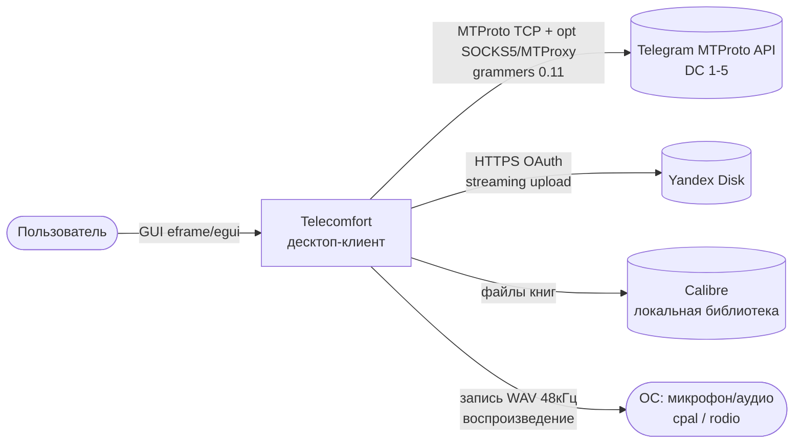
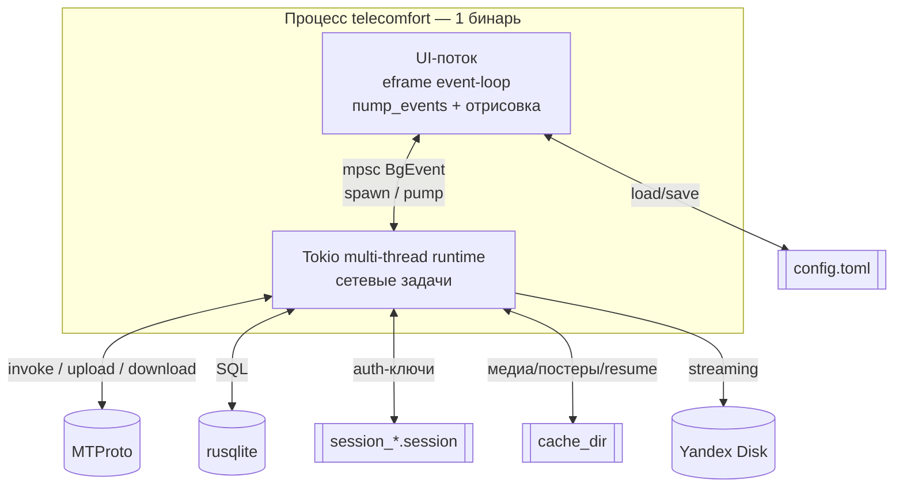
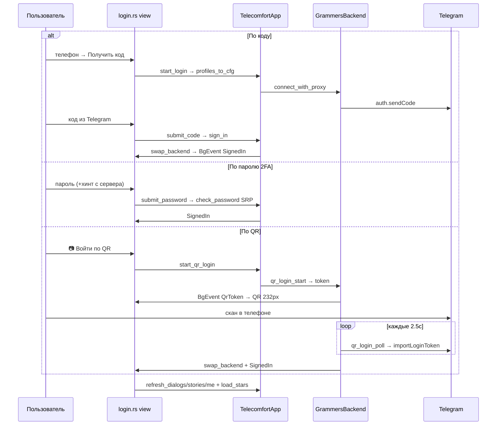
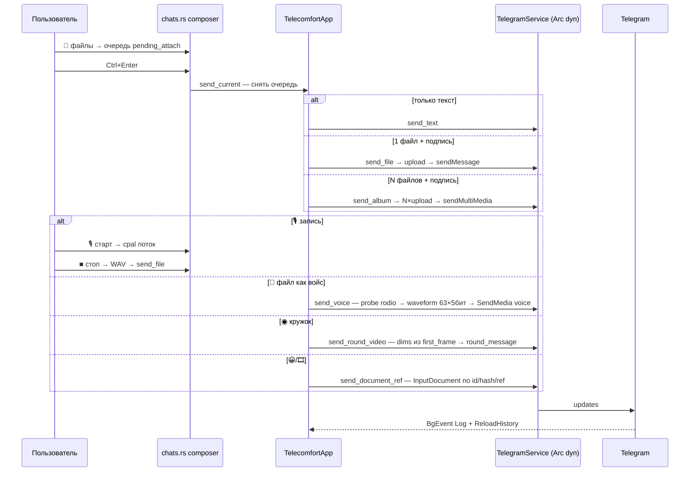
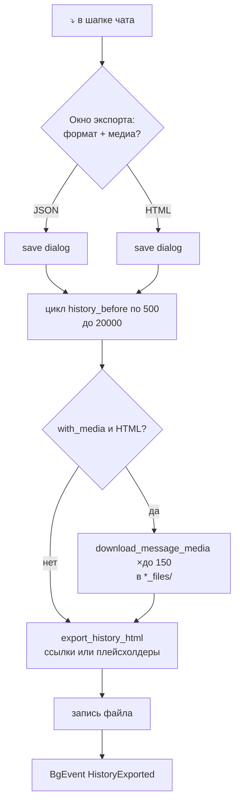
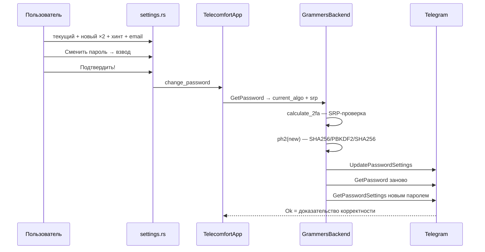
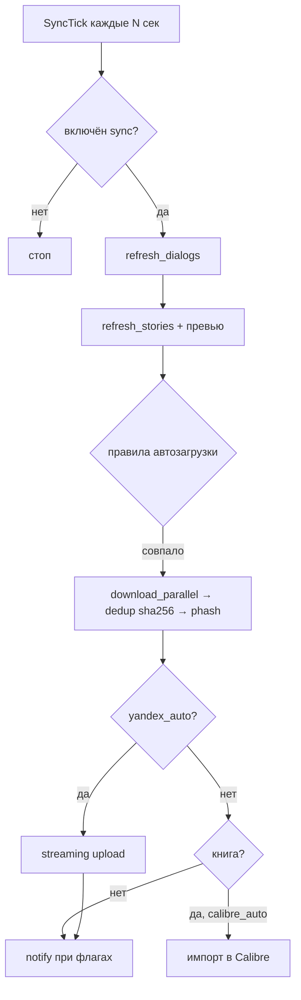
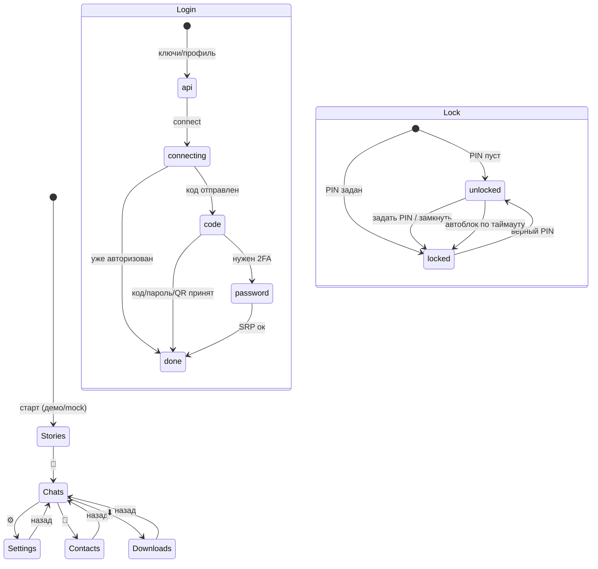
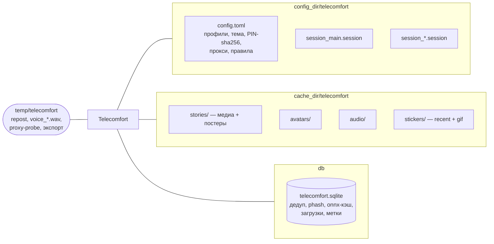

# Telecomfort — диаграммы Mermaid

Рендерятся GitHub, GitLab, VS Code (Markdown Preview Mermaid), Obsidian, kroki.io.
Исходная C4-модель: `architecture-c4.puml`. Нарратив: `ARCHITECTURE.md`.

## 1. Системный контекст

## 2. Контейнеры процесса и потоки данных

## 3. Вход: три способа (sequence)

## 4. Отправка сообщения (sequence)

## 5. Экспорт истории с медиа (flowchart)

## 6. Смена пароля 2FA (sequence)

## 7. Фоновый синк (flowchart)

## 8. Состояния: экраны, вход, блокировка (state)

## 9. Карта хранилища (flowchart)

